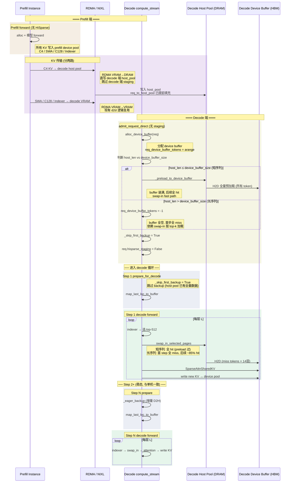
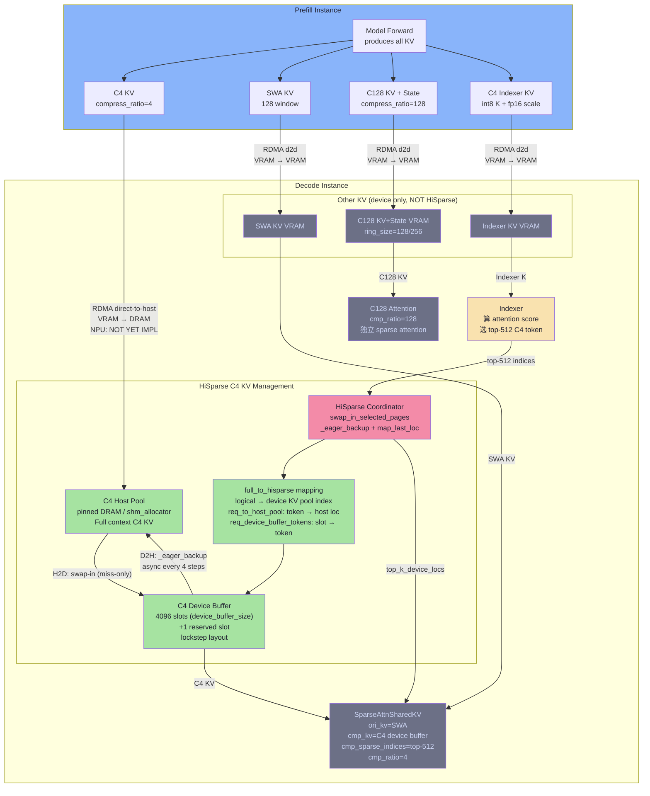

## 1. 基础能力

### 1.1 GPU 公共可复用能力

以下组件是设备无关的，NPU 可直接复用：

| 组件 | 文件 | 复用原因 |
|---|---|---|
| `DeepSeekV4HiSparseTokenToKVPoolAllocator` | `mem_cache/allocator/hisparse.py` | 纯 tensor 操作，双 allocator + mapping 表 |
| `HiSparseHostPoolMixin` | `mem_cache/pool_host/hisparse.py` | CPU 侧 page 分配逻辑 |
| `HiSparseCoordinator` 编排逻辑 | `managers/hisparse_coordinator.py` | `device_module.Stream/Event` 在 NPU 可用 |
| `_eager_backup_previous_token` | coordinator | 异步 D2H backup 编排 |
| `map_last_loc_to_buffer` | coordinator | 最新 token 映射到 device slot |
| `alloc_device_buffer` / `collect_ready_reqs` / `request_finished` | coordinator | 纯 tensor 操作 |
| `ALLOC_MEMORY_FUNCS["npu"]` | `pool_host/common.py` | 已映射到 `alloc_with_pin_memory` |
| `DeepSeekV4PagedHostPool` 结构 | `mem_cache/memory_pool_host.py` | `__init__` 结构 + `get_contiguous_buf_infos` |
| PD decode.py 注册逻辑 | `disaggregation/decode.py` | `kv_data_mem_kinds` 已设备无关 |

Coordinator 中可直接复用的方法：`admit_request_direct`、`admit_request_into_staging`、`collect_ready_reqs`、`_eager_backup_previous_token`、`map_last_loc_to_buffer`、`alloc_device_buffer`、`_grow_device_buffers`、`request_finished`、`retract_req`、`get_token_stats`。

不可复用（需替换）：`_run_swap_in_kernel`（调 CUDA JIT kernel）、`_run_copy_only_kernel`（CUDA copy kernel）、`_preload_to_device_buffer`（依赖 host pool 的 CUDA D2H/H2D kernel）。

### 1.2 PR #636 提供的 NPU 底层算子

[sgl-kernel-npu#636](https://github.com/sgl-project/sgl-kernel-npu/pull/636) 提供三个核心算子：

##### 1.2.1 `shm_allocator` — host 内存分配 + NPU 注册

```python
host_tensor, host_ptr, dev_ptr = create_shm_tensor(
    shape=(num_pages, 64, 1, 512), dtype=torch.bfloat16, device_id=0, name="c4_host"
)
# host_tensor: CPU 侧可直接读写
# dev_ptr: NPU kernel 可直接读写的地址（通过 halHostRegister 注册）
```

底层流程：

1. `shmget` + `shmat` 分配 host 共享内存
2. `halHostRegister(host_ptr, size, flag, device_id, &dev_ptr)` 注册到 NPU
3. 返回 `dev_ptr`：NPU 可见地址

###### 1.2.2 `slot_map_lookup` — hit/miss 检测（plan）

```python
token_on_device, device_token_pos = slot_map_lookup(
    slot_map,        # (num_reqs, max_context_len) int32, logical→device slot 映射, -1=miss
    req_indices,     # (batch,) int32
    topk_indices,    # (batch, 512) int32, indexer 选中的 C4 token 位置
)
# token_on_device:  (batch, 512) int32, 1=hit 0=miss
# device_token_pos: (batch, 512) int32, hit=device slot, miss=0
```

###### 1.2.3  `unidex_copy` — 索引拷贝（IO）

```python
unidex_copy_inplace(
    src=host_kv,              # registered host tensor 或 device tensor
    dst=device_scratch,        # device buffer (HBM)
    src_index=topk_indices,   # 要读哪些行
    dst_index=miss_slots,      # 写到哪些 slot（调用方保证唯一）
    valid_mask=miss_mask,      # 只拷 miss 的
    src_address_ndims=2,       # 前 2 维展平成行索引
    dst_address_ndims=1,
    src_ptr=dev_ptr,           # NPU 可见地址（覆盖 src.data_ptr()）
    dst_ptr=None,
)
```

支持三种传输方向：

- **D2D**：src 和 dst 都在 HBM，`src_ptr=None`
- **H2D**：src 在 registered host，传 `src_ptr=dev_ptr`
- **D2H**：dst 在 registered host，传 `dst_ptr=dev_ptr`

`src` 管形状/dtype（算行大小），`src_ptr` 管实际读取地址。`src_ptr=None` 时用 `src.data_ptr()`（适合 device tensor）。对应 GPU HiSparse fused kernel 的 "IO" 阶段。

### 1.3 PR #33089 提供的 NPU 运行时

[sglang#33089](https://github.com/sgl-project/sglang/pull/33089) 在 PR #636 的算子之上构建了完整的 sparsity-driven KV offload 运行时（针对 DSA 模型，非 DSV4）：

| 组件 | 文件 | 功能 |
|---|---|---|
| `config.py` | `hardware_backend/npu/sparsity_driven_kv_offload/` | 环境开关 + 平台/模型校验 + index-only cell size |
| `manager.py` | 同上 | registered host KV 存储 + 请求生命周期 + slot-map 维护 + 多流 prefetch + cache refill |
| `attention.py` | 同上 | prefill/decode sparse-attention 路径 + DSA index-shape 归一化 |
| `host_callback.py` | 同上 | ACL report-thread + stream-subscription（aclgraph 模式的 host callback） |

设计流程（PR #33089 的方案，有 compact buffer 中间层）：

```
① DSA top-k indices (512 个选中 token)
② slot_map_lookup → hit/miss 判定 + device slot 位置
③ 汇总到 compact buffer（两条流并行）:
   ├── hit:  device cache → D2D copy → compact buffer[i]  (HBM→HBM)
   └── miss: registered host → H2D copy → compact buffer[j]  (DRAM→HBM)
   event join (等两条流都完成)
④ NPU sparse flash attention ← 读 compact buffer
⑤ selected-KV cache refill ← compact buffer 中的新数据回填到 device cache
   (让下步的 hit 率更高)
```

多流并行：hit 的 D2D 和 miss 的 H2D 在不同 NPU stream 上并行，总耗时 = max(D2D, H2D)+refill。

这里先比GPU多了compact buffer和refill。

## 2. 详设

总体上复用GPU Host/Device分层解耦的架构，内存传输上使用[sgl-kernel-npu#636](https://github.com/sgl-project/sgl-kernel-npu/pull/636) 提供的基于共享内存语义实现H2D/D2H入图，具体有以下几个主要工作：

* 基础功能：基于NPU共享内存语义实现H2D/D2H；Swap in不使用额外的compact buffer，H2D直写device buffer，sparse shared attention算子直接访问device buffer取topk token数据；相比[sglang#33089](https://github.com/sgl-project/sglang/pull/33089)节省一步refill操作。
* 支持DSpark：当前社区不支持hisparse开启MTP，如需支持需要verify阶段也做swap in，并考虑extend tokens之间slots去重，避免内存踩踏。
* 支持IndexCache：skip层无需计算topk indices，anchor层新开一条prefetch流做下一层异步的H2D拷贝
* 支持PD分离：社区已支持，NPU需要修改传输后端，使用memory fabric提供的D2RH能力。

### 2.1 基础功能

```mermaid
%%{init: {'themeVariables': {'fontSize': '10px'}, 'sequence': {'mirrorActor': false, 'boxMargin': 9, 'noteMargin': 5}}}%%
sequenceDiagram
    participant WS as write_staging_stream
    participant CB as decode_backup_stream
    participant CO as compute_stream
    participant H as Host Pool (DRAM)
    participant D as Device Buffer (HBM)

    Note over CO,WS: ═══ Extend / Prefill 阶段 ═══

    rect rgb(245, 238, 228)
        Note over CO: forward_extend (prefill)
        CO->>CO: alloc_extend (logical + hisparse)
        Note right of CO: full_to_hisparse mapping 建立<br/>logical_idx → hisparse_device_idx
        loop 每层 L
            CO->>CO: indexer: 算 attention score
            CO->>CO: 选 top-512 (per-query)
            Note right of CO: top-k 形状 [Q_T, KV_N, 512]<br/>HiSparse: 只做索引翻译<br/>无 swap-in (KV 全在 device)
            CO->>D: SparseAttnSharedKV (全量 device KV)
            CO->>D: write KV → C4 device pool
            Note right of CO: set_mla_kv_buffer: loc 翻译后写入
        end
    end

    Note over CO,WS: ═══ Staging 阶段 (prefill → decode 过渡) ═══

    rect rgb(238, 228, 245)
        Note over CO: admit_request_into_staging
        CO->>CO: 取 prefill full_kv_indices
        CO->>CO: 翻译 full → hisparse device indices
        CO->>CO: host pool 分页分配 alloc_paged_token_slots
        CO->>WS: 提交 async D2H (全量 backup)
        Note right of WS: write_staging_stream 上执行
        WS->>D: 读取所有 prefill token
        D->>H: D2H async (全部 token × 14层)
        Note right of WS: 全量 backup, 数据量大<br/>1M 上下文 ≈ 2GB
        WS->>WS: record finish_event
        CO->>CO: 加入 ack_staging_queue
    end

    rect rgb(245, 245, 228)
        Note over CO: collect_ready_reqs (每次调度轮询)
        CO->>CO: finish_event.query() 检查 DMA 完成
        Note right of CO: TP>1: all_reduce(MIN) 各 rank 一致
        CO->>CO: alloc_device_buffer
        Note right of CO: 取回 hisparse indices → 复用为 device buffer<br/>device_buffer_tokens = arange(0,1,2,...)<br/>_skip_first_backup = True
        CO->>CO: req.hisparse_staging = False
        Note right of CO: req 进入 decode batch
    end
Note over CO,CB: ═══ Decode 阶段 ═══

    rect rgb(235, 238, 245)
        Note over CO: Step 1 prepare_for_decode
        Note right of CO: _skip_first_backup = True<br/>跳过首次 backup (staging 已全量 backup)
        CO->>CO: map_last_loc_to_buffer
        Note right of CO: 最新 token → reserved slot<br/>更新 mapping + grow buffer
    end

    rect rgb(230, 245, 235)
        Note over CO: Step 1 decode forward
        loop 每层 L
            CO->>CO: indexer → 选 top-512
            CO->>H: swap_in_selected_pages
            Note right of CO: 首步 miss 率高 (buffer 刚建)<br/>后续 ~85% hit
            H->>D: H2D (miss tokens × 14层)
            CO->>D: SparseAttnSharedKV
            CO->>D: write new KV → device pool
        end
    end

    Note over CO,CB: ── Step 2+ (稳态循环) ──

    rect rgb(235, 238, 245)
        Note over CO: Step N prepare_for_decode
        CO->>CO: wait_for_pending_backup()
        Note right of CO: 等 Step N-1 的 D2H backup 完成
        CO->>CO: _eager_backup_previous_token
        Note right of CO: (seq_len-1) % 4 == 0 时触发<br/>只 backup 1 个压缩 token
        CO->>CB: 提交 async D2H
        CB->>D: 读取 previous compressed token
        D->>H: D2H async (1 token × 14层 ≈ 14KB)
        CB->>CB: record _backup_done_event
        Note left of CB: 异步,不阻塞 compute
        CO->>CO: map_last_loc_to_buffer (续)
        Note right of CO: 最新 token → reserved slot<br/>更新 mapping + grow buffer
    end

    rect rgb(230, 245, 235)
        Note over CO: Step N decode forward
        loop 每层 L
            CO->>CO: indexer → 选 top-512
            CO->>H: swap_in_selected_pages
            Note right of CO: GPU: fused kernel<br/>(hash→hit/miss→LRU→H2D)<br/>NPU: slot_map_lookup + unidex_copy
            H->>D: H2D (miss-only, ~85% hit → ~1MB)
            CO->>D: SparseAttnSharedKV
            CO->>D: write new KV → device pool
        end
    end

    Note over CO,CB: ── Step N+1 (循环) ──
```



##### 2.1.1 核心表

| 表 | 共享/per-layer | 索引→值 | 作用 |
|---|---|---|---|
| `full_to_hisparse_device_index_mapping` | 共享 | logical token → device KV pool 物理位置 | 写 KV / staging backup / newest token 映射 |
| `req_to_host_pool` | 共享 | token 位置 → host pool 物理位置 | swap-in 时查 H2D 源地址；backup 时填充 |
| `req_to_device_buffer` | 共享 | buffer slot → device KV pool 物理位置 | buffer 物理分配，所有层一致 |
| `req_device_buffer_tokens` | **per-layer** | buffer slot → token 位置 | hit/miss 检测：slot 里存了哪个 token |
| `req_device_buffer_token_locs` | **per-layer** | buffer slot → device KV loc | hit 输出 / miss 写入目标 |
| `lru_slots` | **per-layer** | 排序序号 → buffer slot | 决定遍历和淘汰顺序 |
| `top_k_device_locs_buffer` | 共享 | (输出) top-k → device loc | attention 的 page_table |

##### 2.1.2 查表链路（swap-in 核心）

```
top-k token 位置
  │
  ├─ req_to_host_pool[req, token_pos] → host loc (H2D 源)
  │
  └─ 遍历 lru_slots[L] → slot
       └─ req_device_buffer_tokens[L][slot] → 存的 token
            ├─ 在 top-k hash table 命中 → hit
            │    └─ 输出 req_device_buffer_token_locs[L][slot] → device loc
            └─ 未命中 → evictable
                 └─ 取 evict_slot → req_device_buffer_token_locs[L][evict_slot] → device loc (H2D 目标)
                    └─ 更新 req_device_buffer_tokens[L][evict_slot] = miss_token
```

per-layer 的三张表（tokens/locs/lru）是 swap-in 专用的，共享的三张表（mapping/host_pool/device_buffer）是写侧和物理分配用的。两者在 `map_last_loc_to_buffer` 处交汇。

##### 2.1.3 NPU适配

不用slot_map_lookup算子，新写一个triton算子，实现LRU功能，接口定义如下：

```
get_miss_slots()

输入：req_device_buffer_tokens, req_device_buffer_token_locs, lru_slots, topk_indices
输出：miss_token_mask, evict_device_locs, topk_device_locs

1、req_device_buffer_tokens查询hit和miss的token，拿到miss token数量N
2、lru给出N个evict slots
3、evict slots转实际device物理索引
4、更新 req_device_buffer_tokens[L][evict_slot] = miss_token
5、return
```

### 2.2 支持DSpark

```
verify 每层:
  1. 算 top-k: 每 query 独立算 → [num_reqs, gamma+1, top_k]
  2. 新 token 的 device loc 直接填入输出（不需要 swap-in）
  3. 旧 token 的 top-k union 去重 → [num_reqs, (gamma+1)*top_k]
  4. swap-in 
  6. 合并新 token + 旧 token 的 device locs → 传给 attention 算子
```

### 2.3 支持IndexCache

### 2.4 支持PD分离

PD分离和混部的主要差异是跳过staging阶段，无需admit_request_into_staging异步拷贝device kvcache到host，直接在KV后端传输部分调用memory fabric提供的D2RH能力，将KVCache写到远端Decode DRAM上。

时序图：



架构图：


